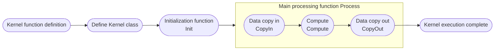

# AI Core Operator Development Guide

<!-- md-trans-meta sourceCommit=unknown translatedAt=2026-11-12T12:15:33.256Z pushedAt=2026-11-18T02:51:06.817Z nl=2 -->

## Overview

### Instructions

Operators are divided into AI Core operators and AI CPU operators (a minority) based on the hardware unit on which they run. AI Core operators are developed using the Ascend C language and run on the AI Core hardware unit. AI CPU operators are developed using the C++ language and run on the AI CPU hardware unit.

This document describes how to develop AI Core operators based on the standard project.

Before developing an operator, understand the following information:

- Basic knowledge: Learn the Ascend C programming language first to understand its basic syntax and principles. Refer to [*Ascend C Operator Development*](https://hiascend.com/en/document/redirect/CannCommunityOpdevAscendC) to become familiar with the hardware architecture and concepts such as operator Tiling and Kernel.
- Development API: For the APIs used during operator development, refer to [*Ascend C Operator Development APIs*](https://hiascend.com/en/document/redirect/CannCommunityAscendCApi) and [*Basic Data Structures and APIs*](https://hiascend.com/en/document/redirect/CannCommunitybasicopapi).
- Operator project migration: For operators already contributed to the [Ascend/samples](https://gitee.com/ascend/samples/tree/master) repository, refer to [Appendix > Operator Project Migration](#operator-project-migration) to migrate existing operators to this project.
- Operator cross-platform migration: For scenarios involving multi-platform operator implementation migration, for example, migrating operator functions already implemented on Atlas A2 to the Ascend 950 platform, refer to [Appendix > Operator Cross-Platform Migration](#operator-cross-platform-migration) to complete the adaptation.

### Development Process

Using the `AddExample` operator as an example, this section describes the complete process and deliverables of standard AI Core operator development. For the complete sample, see the `examples` directory of the project.

1. [Project Creation](#project-creation): Before developing an operator, complete environment deployment and create the operator directory to facilitate subsequent operator compilation and deployment.

2. [Operator Definition](#operator-definition): Determine the operator function and prototype definition.

3. [Tiling Implementation](#tiling-implementation): Implement the operator Tiling function on the host side.

4. [Kernel Implementation](#kernel-implementation): Implement the operator kernel function on the device side.

5. [aclnn Adaptation](#aclnn-adaptation): For custom operators, the aclnn API call is recommended, and binary release must be completed in advance. **If the operator is called in graph mode**, refer to [Graph Mode Adaptation Guide](./graph_develop_guide.md).

6. [Build and Deployment](#build-and-deployment): Complete the compilation and installation of the custom operator through the project build script.

7. [Operator Verification](#operator-verification): Verify the custom operator function through common operator call methods.

## Project Creation

Directory creation is an important step in operator development. It provides a unified directory structure and file organization for subsequent code writing, compilation, and debugging.

Use `build.sh` to quickly create the operator directory. Go to the project root directory and run the following command:

```bash
# Create the specified operator directory, for example, bash build.sh --genop=examples/add_example
# ${op_class} indicates the operator type, for example, the attention type.
# ${op_name} indicates the lowercase underscore form of the operator name. For example, the `AddExample` operator corresponds to add_example. A newly added operator must not have the same name as an existing operator.
bash build.sh --genop=${op_class}/${op_name}
```

After the command is executed successfully, the following prompt information is displayed:

```bash
Create the initial directory for ${op_name} under ${op_class} success
```

After creation, the directory structure is as follows:

```text
${op_name}                              # Replace with the lowercase underscore form of the actual operator name
├── examples                            # Operator call examples
│   ├── test_aclnn_${op_name}.cpp       # Operator aclnn call example
├── op_host                             # Host-side implementation
│   ├── ${op_name}_def.cpp              # Operator information library, defining basic operator information such as name, input/output, and data type
│   ├── ${op_name}_infershape.cpp       # InferShape implementation, implementing operator shape inference to derive the output shape at runtime
│   ├── ${op_name}_tiling.cpp           # Tiling implementation, splitting tensors into multiple small blocks and performing parallel computation by data type
│   └── CMakeLists.txt                  # Host-side cmakelist file
└── op_kernel                           # Device-side Kernel implementation
│   ├── ${op_name}_tiling_key.h         # Tilingkey file, defining the Key of the Tiling policy to identify different split methods
│   ├── ${op_name}_tiling_data.h        # Tilingdata file, storing configuration data related to the Tiling policy, such as block size and parallelism
│   ├── ${op_name}.cpp                  # Kernel entry file, containing the main function and scheduling logic
│   └── ${op_name}.h                    # Kernel implementation file, defining the Kernel header file, including function declarations, structure definitions, and logic implementation
└── CMakeLists.txt                      # Operator cmakelist entry
```

If ```${op_class}``` is a new operator category, additionally add ```add_subdirectory(${op_class})``` to `cmake/custom_build.cmake`. Otherwise, the project cannot be compiled normally. The specific modification is as follows.

```bash
# Compile operators in the examples directory
foreach(EXAMPLES_OP_NAME ${ASCEND_OP_NAME})
    set(EXAMPLES_DIR "${OPS_TRANSFORMER_DIR}/examples/${EXAMPLES_OP_NAME}")
    set(EXAMPLES_MC2_DIR "${OPS_TRANSFORMER_DIR}/examples/mc2/${EXAMPLES_OP_NAME}")
    # When adding an operator category under the examples directory, refer to the mc2 directory and add the command statement as follows:
    # set(EXAMPLES_${op_class}_DIR "${OPS_TRANSFORMER_DIR}/examples/${op_class}/${EXAMPLES_OP_NAME}")
    if(IS_DIRECTORY ${EXAMPLES_DIR})
        add_subdirectory(examples/${EXAMPLES_OP_NAME})
        list(APPEND OP_DIR_LIST ${CMAKE_CURRENT_SOURCE_DIR}/examples/${EXAMPLES_OP_NAME})
    elseif(IS_DIRECTORY ${EXAMPLES_MC2_DIR})
        add_subdirectory(examples/mc2/${EXAMPLES_OP_NAME})
        list(APPEND OP_DIR_LIST ${CMAKE_CURRENT_SOURCE_DIR}/examples/mc2/${EXAMPLES_OP_NAME})
    # When adding an operator category under the examples directory, refer to the mc2 directory and add the command statement as follows:
    # elseif(IS_DIRECTORY ${EXAMPLES_${op_class}_DIR})
    #     add_subdirectory(examples/${op_class}/${EXAMPLES_OP_NAME})
    #     list(APPEND OP_DIR_LIST ${CMAKE_CURRENT_SOURCE_DIR}/examples/${op_class}/${EXAMPLES_OP_NAME})
    endif()
endforeach()
```

```bash
# Compile operators in the experimental directory
if(ENABLE_EXPERIMENTAL)
    # genop adds an experimental operator category
    # add_subdirectory(${op_class})
    add_subdirectory(experimental/attention)
else()
    # genop adds a non-experimental operator category
    # add_subdirectory(${op_class})
    add_subdirectory(attention)
endif()
```

## Operator Definition

Operator definition requires two deliverables: `README.md` and ```${op_name}_def.cpp```

**Deliverable 1: README.md**

Before developing an operator, determine the function and computation logic of the target operator.

Using the custom `AddExample` operator description as an example, refer to [AddExample Operator Description](../../../examples/add_example/README.md).

**Deliverable 2: ${op_name}_def.cpp**

Operator information library.

Using the custom `AddExample` operator description as an example, refer to [AddExample Operator Information Library](../../../examples/add_example/op_host/add_example_def.cpp).

## Tiling Implementation

### Tiling Introduction

Because the internal storage space of the AI Core in the NPU is limited, the entire tensor data cannot be loaded into the computation unit for processing at once. Therefore, the input tensor must be split into multiple small blocks (Tiles) and computed block by block. This process is called Tiling.

The algorithm that guides data splitting is called the Tiling policy or Tiling algorithm. It determines how to split the input data into multiple computation blocks and guides the Kernel on how to allocate memory and schedule computation tasks. Information is transferred between Tiling and Kernel through the `TilingData` structure.

### Code Implementation

Tiling requires three deliverables: ```${op_name}_tiling.cpp``` ```${op_name}_tiling_key.h``` ```${op_name}_tiling_data.h```

> Description:
>
> 1. Place `${op_name}_tiling.cpp` under the `${op_name}/op_host` directory.
> 2. Place `${op_name}_tiling_key.h` and `${op_name}_tiling_data.h` under the `${op_name}/op_kernel` directory.
> 3. If `${op_name}_tiling.cpp` needs to reference `${op_name}_tiling_data.h`, use a relative path, for example: `#include "../op_kernel/${op_name}_tiling_data.h"`.

**Deliverable 1: ${op_name}_tiling.cpp**

Main splitting logic of Tiling.

To view the detailed implementation, refer to [add_example_tiling.cpp](../../../examples/add_example/op_host/add_example_tiling.cpp).

> **Description of empty function implementations in the sample:**
>
> 1. **TilingParse**: A standard deliverable in graph mode. Retain the function definition to satisfy the framework call specification. It can be left empty when there is no actual logic.
> 2. **CompileInfo**: A standard deliverable in graph mode. Retain the function definition to satisfy the framework call specification. It can be left empty when there is no actual logic.

```CPP
// ${op_name}_tiling.cpp
// 1. Tiling needs to obtain runtime environment information, including the number of available cores and the UB (Unified Buffer) size, and pass the obtained information to CompileInfo. Automatic generation of aclnn does not call this function. Directly return ge::GRAPH_SUCCESS.
static ge::graphStatus TilingParse(gert::TilingParseContext* context)
{
    return ge::GRAPH_SUCCESS;
    // If the aclnn API is written manually, complete the parse function according to the following steps.
    // // 1.1 Obtain environment information.
    // auto compileInfo = context->GetCompiledInfo<CompileInfo>();
    // OP_CHECK_NULL_WITH_CONTEXT(context, compileInfo);
    // auto platformInfo = context->GetPlatformInfo();
    // auto ascendcPlatform = platform_ascendc::PlatformAscendC(platformInfo);
    // // 1.2 Obtain the number of available cores.
    // compileInfo->totalCoreNum = ascendcPlatform.GetCoreNumAiv();
    // // 1.3 Obtain the UB size.
    // uint64_t ubSizePlatForm;
    // ascendcPlatform.GetCoreMemSize(platform_ascendc::CoreMemType::UB, ubSizePlatForm);
    // compileInfo->ubSize = static_cast<int64_t>(ubSizePlatForm);
    // ...
    // return ge::GRAPH_SUCCESS;
}

// 2. Main entry of Tiling computation.
static ge::graphStatus TilingFunc(gert::TilingContext* context){
    // 2.1 Obtain platform information.
    uint64_t ubSize;
    int64_t coreNum;
    OP_CHECK_IF(
        GetPlatformInfo(context, ubSize, coreNum) != ge::GRAPH_SUCCESS, OP_LOGE(context, "GetPlatformInfo error"),
        return ge::GRAPH_FAILED);

    // 2.2 Obtain input information.
    // Obtain the shape information of the input tensor.
    auto inputX = context->GetInputShape(0);
    OP_CHECK_NULL_WITH_CONTEXT(context, inputX);

    // If the input shape is a scalar, convert it to {1}. Otherwise, retain the original shape.
    auto inputShapeX = EnsureNotScalar(inputX->GetStorageShape());

    // Obtain the description information of the input tensor.
    auto inputDesc = context->GetInputDesc(0);
    OP_CHECK_NULL_WITH_CONTEXT(context, inputDesc);

    // Obtain the data type.
    dataType = inputDesc->GetDataType();

    // 2.3 Compute Tiling parameters (design them according to the operator function).
    ...

    // 2.4 Set TilingData information.
    ${op_name}TilingData* tiling = context->GetTilingData<${op_name}TilingData>();
    OP_CHECK_NULL_WITH_CONTEXT(context, tiling);
    OP_CHECK_IF(
        memset_s(tiling, sizeof(${op_name}TilingData), 0, sizeof(${op_name}TilingData)) != EOK,
        OP_LOGE(context, "set tiling data error"), return ge::GRAPH_FAILED);
    tiling->totalLength = totalIdx;
    tiling->tileNum = TILE_NUM;

    // 2.5 Set WorkspaceSize (optional).
    size_t* currentWorkspace = context->GetWorkspaceSizes(1);
    OP_CHECK_NULL_WITH_CONTEXT(context, currentWorkspace);
    currentWorkspace[0] = WS_SYS_SIZE;
}

// 3. Tiling registration entry.
IMPL_OP_OPTILING(${op_name}).Tiling(TilingFunc).TilingParse<CompileInfo>(TilingParse);
```

**Deliverable 2: ${op_name}_tiling_key.h**

TilingKey is a method of distinguishing kernel code within an operator to differentiate different implementations. The kernel side can use TilingKey to select different algorithm logic.

To view the detailed implementation, refer to [add_example_tiling_key.h](../../../examples/add_example/op_kernel/add_example_tiling_key.h).

> **Description:** To implement branch selection with complex parameter combinations (involving multiple TilingKey use cases), refer to "Utils API > Tiling template programming > Template parameter meaning" in [*Ascend C Operator Development APIs*](https://hiascend.com/en/document/redirect/CannCommunityAscendCApi).

```CPP
// ${op_name}_tiling_key.h
ASCENDC_TPL_ARGS_DECL(
    ${op_name},
    ASCENDC_TPL_UINT_DECL(schMode, 1, ASCENDC_TPL_UI_LIST, ELEMENTWISE_TPL_SCH_MODE_0, ELEMENTWISE_TPL_SCH_MODE_1));

ASCENDC_TPL_SEL(ASCENDC_TPL_ARGS_SEL(
    ASCENDC_TPL_UINT_SEL(schMode, ASCENDC_TPL_UI_LIST, ELEMENTWISE_TPL_SCH_MODE_0, ELEMENTWISE_TPL_SCH_MODE_1)));
```

**Deliverable 3: ${op_name}_tiling_data.h**

Parameters related to the splitting algorithm, such as the total data size and the number of data blocks per core, are stored through a structure.

To view the detailed implementation, refer to [add_example_tiling_data.h](../../../examples/add_example/op_kernel/add_example_tiling_data.h).

```CPP
// ${op_name}_tiling_data.h
struct ${op_name}TilingData {
    int64_t totalLength;
    int64_t tileNum;
};
```

## Kernel Implementation

### Kernel Introduction

Kernel is the core part of operator execution on the NPU. It is responsible for loading, computing, and storing tensor data, and is the final carrier of operator function implementation. The Kernel implementation must work closely with the Tiling policy, and perform memory allocation and computation scheduling according to the `TilingData` and `TilingKey` information provided by Tiling.

Kernel implementation includes the following steps. The entire process is connected through the `Process` function to implement the complete operator process.



### Code Implementation

The kernel requires two deliverables: ```${op_name}.cpp``` and ```${op_name}.h```.

> Note:
>
> 1. `${op_name}.cpp` is the kernel entry function and can only be placed under the `${op_name}/op_kernel` directory.
> 2. The `${op_name}.h` file can be placed under the corresponding directory according to different SoCs or templates, for example, `${op_name}/op_kernel/arch22`, `${op_name}/op_kernel/arch35`, or `${op_name}/op_kernel/impl`.

**Deliverable 1: ${op_name}.cpp**

The kernel entry file, which contains the main function and scheduling logic.

To view the detailed implementation, refer to [add_example.cpp](../../../examples/add_example/op_kernel/add_example.cpp).

```cpp
// 1. Kernel function definition
// schMode is a template parameter used to support computation paths for different data types (such as float and int32).
// __global__ __aicore__ indicates that this function is a global function and can be executed on the AI Core.
template <uint32_t schMode>
__global__ __aicore__ void add_example(GM_ADDR x, GM_ADDR y, GM_ADDR z, GM_ADDR workspace, GM_ADDR tiling){
    ....
    // Tiling registration entry
    REGISTER_TILING_DEFAULT(AddExampleTilingData);

    // Obtain TilingData through a macro.
    GET_TILING_DATA_WITH_STRUCT(AddExampleTilingData, tilingData, tiling);

    // Instantiate the Kernel object according to TilingKey and complete the computation.
    if constexpr (schMode == static_cast<uint32_t>(AddExampleTilingKey::TILING_KEY_EXAMPLE_FLOAT)) { // The float data type takes this branch.
        NsAddExample::AddExample<float> op;     // Obtain the operator kernel instance.
        op.Init(x, y, z, &tilingData);          // Initialize the operator kernel instance.
        op.Process();                           // Execute the operator kernel instance.
    }
    ....
}
```

**Deliverable 2: ${op_name}.h**

Defines the kernel header file, which contains function declarations, structure definitions, and logic implementation.

To view the detailed implementation, refer to [add_example.h](../../../examples/add_example/op_kernel/add_example.h).

```cpp
// 2. Define the Kernel class.
template <typename T>
class AddExample
{
public:
    // Default constructor. __aicore__ indicates that this function runs on the AI Core.
    __aicore__ inline AddExample(){};
    // Initialization function, used to set the input and output addresses and compute the Tiling split information.
    __aicore__ inline void Init(GM_ADDR x, GM_ADDR y, GM_ADDR z, const AddExampleTilingData* tilingData);
    // Main processing function, which performs data copy and computation.
    __aicore__ inline void Process();

private:
    // Function that copies data from GM to LM.
    __aicore__ inline void CopyIn(int32_t progress);
    // Function that copies data from LM to GM.
    __aicore__ inline void CopyOut(int32_t progress);
    // Function that performs computation. datalength indicates the length of the data currently being processed.
    __aicore__ inline void Compute(const int32_t dataLength);

private:
    // Pipeline object, used to manage the data flow (the pipeline of copy and computation).
    TPipe pipe_;
    // Input queue X, copied from GM to LM. BUFFER_NUM indicates the buffer quantity. Double buffering is enabled to achieve pipeline parallelism, and the value is 2.
    TQue<QuePosition::VECIN, BUFFER_NUM> inputQueueX_;
    // Input queue Y, copied from GM to LM. BUFFER_NUM indicates the buffer quantity. Double buffering is enabled to achieve pipeline parallelism, and the value is 2.
    TQue<QuePosition::VECIN, BUFFER_NUM> inputQueueY_;
    // Output queue Z, copied from LM to GM. BUFFER_NUM indicates the buffer quantity. Double buffering is enabled here to achieve pipeline parallelism, and the value is 2.
    TQue<QuePosition::VECOUT, BUFFER_NUM> outputQueueZ_;

    // GM address of input X.
    GlobalTensor<T> inputGMX_;
    // GM address of input Y.
    GlobalTensor<T> inputGMY_;
    // GM address of input Z.
    GlobalTensor<T> outputGMZ_;

    // Total data length.
    int64_t blockLength_ = 0;
    // Number of blocks into which each block is divided.
    int64_t tileNum_ = 0;
    // Data length processed by each tile.
    int64_t tileLength_ = 0;
    ...
};

// 3. Initialization function Init.
template <typename T>
__aicore__ inline void AddExample<T>::Init(GM_ADDR x, GM_ADDR y, GM_ADDR z, const AddExampleTilingData* tilingData)
{
    // 3.1 Initialize member variables.
    blockLength_ = tilingData->totalLength / AscendC::GetBlockNum();
    ...
    // 3.2 Initialize GM addresses.
    inputGMX.SetGlobalBuffer((__gm__ T*)x + blockLength_ * AscendC::GetBlockIdx(), blockLength_);
    ...
    // 3.3 Initialize queue lengths.
    pipe.InitBuffer(inputQueueX_, BUFFER_NUM, tileLength_ * sizeof(T));
    ...
}

// 4. Main processing function Process.
template <typename T>
__aicore__ inline void AddExample<T>::Process()
{
    // Compute the number of data processing loops for the current core.
    int32_t loopCount = tileNum_ * BUFFER_NUM;
    for (int32_t i = 0; i < loopCount; i++) {
        CopyIn(i);              // Move data in.
        Compute(i);             // Compute.
        CopyOut(i);             // Move data out.
    }
}
...
```

## aclnn Adaptation

After operator development and compilation are complete, the aclnn API (a set of C-based APIs) is automatically generated. The aclnn API can be called directly in an application to call the operator.

To implement this call method, generate the binary package corresponding to the operator in advance. This project does not require manual configuration. The operator binary package is automatically generated through ${op_name}_def.cpp, which supports direct use by developers.

## Build and Deployment

After operator development is complete, compile the operator project to generate the custom operator installation package \*\.run. Perform the following operations:

1. **Prepare the environment.**

    Refer to [Project Creation](#project-creation) to complete the basic environment setup. Check whether the operator development deliverables are complete and located in the corresponding operator classification directory.

2. **Configure environment variables.**

    Select the appropriate command according to the actual use case.

    ```bash
    # Default path installation, using the root user as an example (for non-root users, replace /usr/local with ${HOME})
    source /usr/local/Ascend/cann/set_env.sh
    # Installation to a specified path
    # source ${install_path}/cann/set_env.sh
    ```

3. **Compile the custom operator package.**

    Take the `AddExample` operator as an example. Assume the development deliverables are in the `examples` directory. For the complete code, refer to the [add_example](../../../examples/add_example) directory.

    > Note: Compilation depends on third-party open-source software. In online scenarios, it is downloaded automatically. In offline compilation scenarios, install it manually. For details, refer to [Offline Compilation](../install/compile.md#offline-compilation).

    ```bash
    # Compile the specified operator, for example, bash build.sh --pkg --ops=add_example
    bash build.sh --pkg --soc=${soc_version} --vendor_name=${vendor_name} --ops=${op_list} [--experimental]
    ```

    - --soc: \$\{soc\_version\} indicates the NPU model. Atlas A2 products use "ascend910b" (default), Atlas A3 products use "ascend910_93", and Ascend 950PR&950DT products use "ascend950".
    - --vendor_name (optional): \$\{vendor\_name\} indicates the name of the custom operator package to build. The default name is custom.
    - --ops (optional): \$\{op\_list\} indicates the operators to compile. If not specified, all operators are compiled by default. The format is "--ops=add_example".
    - --experimental (optional): If the operator to compile is a contributed operator, configure --experimental.

    If the following information is displayed, the compilation is successful:

    ```bash
    Self-extractable archive "cann-ops-transformer-${vendor_name}_linux-${arch}.run" successfully created.
    ```

4. **Install the custom operator package.**

    ```bash
    # Install the run package
    ./build_out/cann-ops-transformer-${vendor_name}_linux-${arch}.run
    ```

    The custom operator package is installed in the ```${ASCEND_HOME_PATH}/opp/vendors``` path. ```${ASCEND_HOME_PATH}``` indicates the CANN software installation directory, which can be configured in environment variables in advance.

5. **(Optional) Delete the custom operator package.**

    Note that the custom operator package does not support uninstallation. To remove it, delete the vendors\/\$\{vendor\_name} directory and delete the configuration item corresponding to \$\{vendor\_name\} in load_priority in vendors/config.ini.

## Operator Verification

During operator development, verification can be performed in the following ways:

1. [UT Verification](#ut-verification): Verify whether the deliverable code can run normally. UT verification does not require an NPU environment.

2. [aclnn Call Verification](#aclnn-call-verification): Verify the function of the operator in the NPU environment. aclnn call verification requires an NPU environment.

### UT Verification

During the development of the main deliverable code, UT verification can be used for quick verification without compiling and deploying the operator package.

The UT directory structure is as follows. It must be created manually by the user:

```bash
${op_name}
...                                                     # Other deliverables
└── tests                                               # Test deliverables
    └── ut                                              # UT implementation
        ├── op_host
        │   └── test_${op_name}_tiling.cpp              # Tiling UT implementation
        │   └── test_${op_name}_infershape.cpp          # Infershape UT implementation
        └── op_kernel
            └── test_${op_name}.cpp                     # Kernel UT implementation
```

For the command to execute UT verification, refer to [Operator Call](../invocation/quick_op_invocation.md). The following describes the writing of each UT deliverable in turn.

#### Infershape UT

Infershape UT is used to verify whether the host-side Infershape logic is correct. After the inputs of a given operator are provided, it verifies whether Infershape can execute correctly and whether the output meets expectations. It is recommended to supplement during operator development.

The UT writing guide is as follows. To view the detailed implementation, refer to the sample UT implementation [test_add_example_infershape.cpp](../../../examples/add_example/tests/ut/op_host/test_add_example_infershape.cpp).

**1. Organizational Structure and Naming Suggestions**

- **Header files**: Uniformly include `iostream`, `gtest/gtest.h`, `infer_shape_context_faker.h`, and `infer_shape_case_executor.h`.
- **Test class**: Inherit `testing::Test`, and implement `SetUpTestCase/TearDownTestCase` for unified data preparation and cleanup.
- **Naming**: The test class is recommended to be `${OpName}InfershapeTest`, and the test case name is recommended to be `test_case_xxx` for higher readability.

Test class example:

```CPP
class ${OpName}InfershapeTest : public testing::Test {
protected:
    static void SetUpTestCase()
    {
        std::cout << "${OpName}InfershapeTest SetUp" << std::endl;
    }
    static void TearDownTestCase()
    {
        std::cout << "${OpName}InfershapeTest TearDown" << std::endl;
    }
};
```

**2. Basic Test Case Flow**

1) Call the API to construct the test case context. The required parameters are mainly the shape/format/dtype of the input and output.
    - shape/format/dtype can refer to the `${op_name}_def.cpp` operator information library
    - If an input is marked as `ValueDepend` in the information library, the **real data value** of the input must also be prepared in the UT.
2) Set the expected results.
3) Call the API to execute the test case.

Simplified example:

```CPP
TEST_F(${OpName}InfershapeTest, test_case_xxx)
{
    // 1. Construct the test case context
    gert::InfershapeContextPara infershapeContextPara(
        "${OpName}",
        {
            {{{1, -1, -1, 64}, {1, -1, -1, 64}}, ge::DT_FLOAT16, ge::FORMAT_ND},  // input tensor1
            {{{1, -1, -1, 64}, {1, -1, -1, 64}}, ge::DT_FLOAT16, ge::FORMAT_ND},  // input tensor2
            // If the input is ValueDepend, additionally pass in the two parameters true and constValue
            // constValue is a user-defined variable, for example, int constValue[2] = {2, 2}
            // {{{32, 4, 4, 4}, {32, 4, 4, 4}}, ge::DT_FLOAT, ge::FORMAT_ND, true, constValue}
        },
        {
            {{{}, {}}, ge::DT_FLOAT16, ge::FORMAT_ND},  // output tensor
        }
    );
    // 2. Set the expected results
    std::vector<std::vector<int64_t>> expectOutputShape = {
        {1, -1, -1, 64},
    };
    // 3. Call the API to execute the test case
    ExecuteTestCase(infershapeContextPara, ge::GRAPH_SUCCESS, expectOutputShape);
}
```

#### Tiling UT

Tiling UT verifies whether the host-side Tiling logic is correct. After the inputs of a given operator are provided, it checks whether Tiling can execute correctly and whether the output meets expectations. It is recommended to supplement during operator development.

The UT writing guide is as follows. To view the detailed implementation, refer to the sample UT implementation [test_add_example_tiling.cpp](../../../examples/add_example/tests/ut/op_host/test_add_example_tiling.cpp).

**1. Organizational structure and naming suggestions**

- **Header file**: uniformly include `iostream`, `gtest/gtest.h`, `tiling_context_faker.h`, and `tiling_case_executor.h`.
  - If the CompileInfo structure is already defined in the tiling header file, it must also be included.
- **Test class**: inherit `testing::Test`, and implement `SetUpTestCase/TearDownTestCase` to uniformly perform data preparation and cleanup.
- **Naming**: the test class is recommended to be `${OpName}TilingTest`, and the test case name is recommended to be `test_case_xxx` for higher readability.

Test class example:

```CPP
class ${OpName}TilingTest : public testing::Test {
protected:
    static void SetUpTestCase()
    {
        std::cout << "${OpName}TilingTest SetUp" << std::endl;
    }

    static void TearDownTestCase()
    {
        std::cout << "${OpName}TilingTest TearDown" << std::endl;
    }
};
```

**2. Basic test case flow**

1) Call API to construct the test case context. The required parameters are mainly the shape/format/dtype of inputs and outputs, attributes, and compileInfo. Refer to the `${op_name}_def.cpp` operator information library.
    - The shape/format/dtype and attributes can refer to the `${op_name}_def.cpp` operator information library.
    - If an input is marked as `ValueDepend` in the information library, the **real data value** of that input must also be prepared in the UT.
    - For compileInfo, preferentially use the structure declared in the tiling header file. If the tiling header file does not declare it, declare it in the test case.
2) Set expected results.
3) Call API to execute the test case.

Simplified example:

```CPP
TEST_F(${OpName}TilingTest, test_case_xxx)
{
    // Declare the structure and initialize a structure variable.
    struct ${OpName}CompileInfo {
    } compileInfo;
    // 1. Construct the test case context.
    gert::TilingContextPara tilingContextPara(
        "${OpName}",
        {
            {{{32, 4, 4, 4}, {32, 4, 4, 4}}, ge::DT_FLOAT, ge::FORMAT_ND}, // input tensor1
            {{{32, 4, 4, 4}, {32, 4, 4, 4}}, ge::DT_FLOAT, ge::FORMAT_ND}, // input tensor2
            // If the input is ValueDepend, additionally pass in the two parameters true and constValue.
            // constValue is a user-defined variable, for example, int constValue[2] = {2, 2}.
            // {{{32, 4, 4, 4}, {32, 4, 4, 4}}, ge::DT_FLOAT, ge::FORMAT_ND, true, constValue}
        },
        {
            {{{32, 4, 4, 4}, {32, 4, 4, 4}}, ge::DT_FLOAT, ge::FORMAT_ND}, // output tensor
        },
        {
            // Attributes.
            gert::TilingContextPara::OpAttr("${attr_name}", AnyValue::CreateFrom<std::string>("${attr_value}"))
        },
        &compileInfo,
        64,     // Number of cores obtained in the tiling phase.
        262144, // UB size obtained in the tiling phase, but the actually obtained value is 256 bytes less than the specified value.
        4096    // Specify the maximum value of tiling data in the tiling phase.
    );
    // 2. Set expected results.
    uint64_t expectTilingKey = 0;
    string expectTilingData = "2048 32 10912 ";
    std::vector<size_t> expectWorkspaces = {0};
    // 3. Call API to execute the test case.
    ExecuteTestCase(tilingContextPara, ge::GRAPH_SUCCESS, expectTilingKey, expectTilingData, expectWorkspaces);
}
```

#### Kernel UT

Kernel UT is used to verify whether the device-side Kernel logic is correct. Given the input/Tiling parameters, it checks whether the Kernel can execute correctly and whether the output meets expectations. It is recommended to supplement during operator development.

The UT writing guide is as follows. To view the detailed implementation, refer to the sample UT implementation [test_add_example.cpp](../../../examples/add_example/tests/ut/op_kernel/test_add_example.cpp).

**1. Organizational structure and naming suggestions**

- **Header file**: It is recommended to uniformly include `gtest/gtest.h`, `tikicpulib.h`, `data_utils.h`, and the Tiling header file.
  - Directly reference `op_host/${op_name}_tiling.h`
  - Or provide a lightweight adaptation header in the UT directory (such as `examples/add_example/tests/ut/op_kernel/add_example_tiling.h`)
  - If the Kernel is a template function, directly `#include "../../../op_kernel/${op_name}.cpp"` in the UT to trigger instantiation (refer to `AddExample`)
- **Test class**: Inherit `testing::Test` and implement `SetUpTestCase/TearDownTestCase` to uniformly perform data preparation and cleanup (such as copying the data directory, chmod, and generating bin).
- **Naming**: The test class is recommended to be `${OpName}KernelTest`, and the test case name is recommended to be `test_case_xxx` for higher readability.

Test class example:

```CPP
class ${OpName}KernelTest : public testing::Test {
protected:
    static void SetUpTestCase()
    {
        std::cout << "${OpName}KernelTest SetUp" << std::endl;
        // Uniformly prepare test data here.
    }
    static void TearDownTestCase()
    {
        std::cout << "${OpName}KernelTest TearDown" << std::endl;
    }
};
```

**2. Basic test case flow**

1) Set the input shape/format/dtype. For first-time use, refer to the `${op_name}_def.cpp` operator information library.
    - If an input is marked as `ValueDepend` in the information library, the UT must simultaneously prepare the **real data value** of that input.
2) Prepare the input/output/Workspace/Tiling buffers (`AscendC::GmAlloc`).
3) Prepare the Tiling data (manually constructed or generated by the Tiling function).
4) Set `ICPU_SET_TILING_KEY` and `AscendC::SetKernelMode`.
5) Use `ICPU_RUN_KF` to execute the Kernel.
6) Verify the result and release resources (`AscendC::GmFree`).

Simplified example:

```CPP
extern "C" __global__ __aicore__ void ${op_name}(GM_ADDR x, GM_ADDR y, GM_ADDR z,
                                                GM_ADDR workspace, GM_ADDR tiling);

TEST_F(${OpName}KernelTest, test_case_basic)
{
    // 1. Set the input shape/format/dtype, and prepare the ValueDepend input value if necessary.
    // 2. Allocate input/output/workspace/tiling memory.
    uint8_t* x = (uint8_t*)AscendC::GmAlloc(...);
    uint8_t* y = (uint8_t*)AscendC::GmAlloc(...);
    uint8_t* z = (uint8_t*)AscendC::GmAlloc(...);
    uint8_t* workspace = (uint8_t*)AscendC::GmAlloc(...);
    uint8_t* tiling = (uint8_t*)AscendC::GmAlloc(sizeof(${op_name}TilingData));

    // 3. Prepare the tiling data (manually constructed or generated by the tiling function).
    auto* tilingData = reinterpret_cast<${op_name}TilingData*>(tiling);
    tilingData->... = ...;

    // 4. Set the tiling key and execute the kernel.
    ICPU_SET_TILING_KEY(tilingKey);
    AscendC::SetKernelMode(KernelMode::AIV_MODE);
    ICPU_RUN_KF(${op_name}, blockDim, x, y, z, workspace, tiling);

    // 5. Verify the result.
    EXPECT_EQ(..., ...);

    // 6. Release resources.
    AscendC::GmFree(x);
    AscendC::GmFree(y);
    AscendC::GmFree(z);
    AscendC::GmFree(workspace);
    AscendC::GmFree(tiling);
}
```

**3. Tiling data preparation method**

- **Manual construction**: Suitable for few fields and simple logic.
- **Automatic generation by calling the Tiling function**: Suitable for many fields and complex attribute/shape dependencies. `tests/ut/framework_normal/common/tiling_context_faker.h` and `tiling_case_executor.h` can be reused. Example:

```CPP
gert::TilingContextPara para("OpName",
    {{{{2, 2, 2, 1}, {2, 2, 2, 1}}, ge::DT_FLOAT, ge::FORMAT_ND}},
    {{{{2, 1, 2, 2}, {2, 1, 2, 2}}, ge::DT_FLOAT, ge::FORMAT_ND}},
    {gert::TilingContextPara::OpAttr("attr", AnyValue::CreateFrom<int64_t>(1))},
    &compileInfo);

TilingInfo tilingInfo;
ASSERT_TRUE(ExecuteTiling(para, tilingInfo));
uint8_t* tiling = (uint8_t*)AscendC::GmAlloc(tilingInfo.tilingDataSize);
std::memcpy(tiling, tilingInfo.tilingData.get(), tilingInfo.tilingDataSize);
ICPU_SET_TILING_KEY(tilingInfo.tilingKey);
uint32_t blockDim = tilingInfo.blockNum;
```

**4. Data generation and result comparison**

- `ReadFile/WriteFile` in `tests/ut/framework_normal/op_kernel/data_utils.h` can be used to read and write binary data.
- Use the `gen_data.py`/`compare_data.py` scripts to generate and compare data. Refer to the `add_example_data` directory of `add_example`:
  [gen_data.py](../../../examples/add_example/tests/ut/op_kernel/add_example_data/gen_data.py),
  [compare_data.py](../../../examples/add_example/tests/ut/op_kernel/add_example_data/compare_data.py).
- For simple operators, the expected value can be computed directly in the UT and compared.
  - For floating-point comparison, it is recommended to use `EXPECT_NEAR/ASSERT_NEAR` and set a reasonable tolerance.

### aclnn call verification

```bash
# Import environment variables before execution.
export LD_LIBRARY_PATH=${ASCEND_HOME_PATH}/opp/vendors/${vendor_name}_transformer/op_api/lib:${LD_LIBRARY_PATH}
```

After the developed operator is compiled and deployed, its function can be verified through the aclnn method. Refer to [operator call method](../invocation/quick_op_invocation.md).

## Appendix

### Operator Project Migration

Because the [Ascend/samples](https://gitee.com/ascend/samples/tree/master) project differs from this project (see [Project Creation](#project-creation)), the operator implementation deliverables and quantities differ. Refer to the following table to migrate the operator samples in the `operator` directory.

<table border="1">
  <tr>
    <th>Ascend/samples</th>
    <th>Project</th>
    <th>Migration Method</th>
    <th>Sample Code</th>
  </tr>
  <tr>
    <td rowspan="4">op_host/{op_name}.cpp</td>
    <td>op_host/{op_name}_def.cpp</td>
    <td>Extract the operator prototype description from the original op_host/{op_name}.cpp.</td>
    <td><a href="#op_host/{op_name}_def.cpp">op_host/{op_name}_def.cpp</a>
    </td>
  </tr>
  <tr>
    <td>op_host/{op_name}_infershape.cpp</td>
    <td>(Optional) Extract the shape inference part from the original op_host/{op_name}.cpp.</td>
    <td><a href="#op_host/{op_name}_infershape.cpp">op_host/{op_name}_infershape.cpp</a>
    </td>
  </tr>
  <tr>
    <td>op_host/{op_name}_tiling.cpp</td>
    <td>Retain only TilingFunc from the original op_host/{op_name}.cpp.</td>
    <td><a href="#op_host/{op_name}_tiling.cpp">op_host/{op_name}_tiling.cpp</a></td>
  </tr>
  <tr>
    <td>op_graph/{op_name}_graph_infer.cpp</td>
    <td>(Optional) Extract the type inference part from the original op_host/{op_name}.cpp.</td>
    <td><a href="#op_graph/{op_name}_graph_infer.cpp">op_graph/{op_name}_graph_infer.cpp</a></td>
  </tr>
  <tr>
    <td>op_host/{op_name}_tiling.h</td>
    <td>op_kernel/{op_name}_tiling_data.h</td>
    <td>Change the macro-defined Tiling structure in the original op_host directory to a standard C++ definition.</td>
    <td><a href="#op_kernel/{op_name}_tiling_data.h">op_kernel/{op_name}_tiling_data.h</a></td>
  </tr>
  <tr>
    <td rowspan="2">op_kernel/{op_name}.cpp</td>
    <td>op_kernel/{op_name}.h</td>
    <td>Retain the operator class definition part of the Kernel implementation from the original op_host/{op_name}.cpp.</td>
    <td><a href="#op_kernel/{op_name}.h">op_kernel/{op_name}.h</a></td>
  </tr>
  <tr>
    <td>op_kernel/{op_name}.cpp</td>
    <td>Migrate the kernel function of the Kernel implementation from the original op_host/{op_name}.cpp to the cpp file. Simultaneously:
      <li>Add a REGISTER_TILING_DEFAULT call to register the Tiling structure, and use GET_TILING_DATA_WITH_STRUCT to obtain TilingData.</li>
      <li>Add a Tiling template to support template parameter passing, and select different Kernel-side implementations based on template parameter branches.</li>
    </td>
    <td><a href="#op_kernel/{op_name}.cpp">op_kernel/{op_name}.cpp</a></td>
  </tr>
  <tr>
    <td>op_kernel/tiling_key_{op_name}.h</td>
    <td>op_kernel/{op_name}_tiling_key.h</td>
    <td>Retain the template parameter definition of the operator in the original op_kernel/tiling_key_{op_name}.h. If op_kernel/tiling_key_{op_name}.h does not exist, add the definition of template parameters and template parameter combinations.</td>
    <td><a href="#op_kernel/{op_name}_tiling_key.h">op_kernel/{op_name}_tiling_key.h</a></td>
  </tr>
</table>

<div id="op_host/{op_name}_def.cpp">
<p style="font-size:18px;"><b>op_host/{op_name}_def.cpp</b></p>
</div>

Migrate the operator information library content from the original ${op_name}.cpp to this file. Remove the SetInferShape and SetTiling content.

```CPP
// Operator information library content in the original ${op_name}.cpp
namespace ops {
class AddCustom : public OpDef {
public:
    explicit AddCustom(const char *name) : OpDef(name)
    {
        this->Input("x")
        ....
        this->Output("z")
            .ParamType(REQUIRED)
            .DataType({ge::DT_FLOAT16, ge::DT_FLOAT})
            .Format({ge::FORMAT_ND, ge::FORMAT_ND});

        this->SetInferShape(ge::InferShape).SetInferDataType(ge::InferDataType);   // Remove SetInferShape.
        this->AICore()
            .SetTiling(optiling::TilingFunc)                                       // Remove SetTiling.
            .AddConfig("ascend910")
            .AddConfig("ascend310p")
            .AddConfig("ascend310b")
            .AddConfig("ascend910b");
    }
};
OP_ADD(AddCustom);
} // namespace ops

// After migration to op_host/{op_name}_def.cpp, the code contains no SetInferShape or SetTiling content.
namespace ops {
class AddCustom : public OpDef {
public:
    explicit AddCustom(const char *name) : OpDef(name)
    {
        this->Input("x")
        ....
        this->Output("z")
            .ParamType(REQUIRED)
            .DataType({ge::DT_FLOAT16, ge::DT_FLOAT})
            .Format({ge::FORMAT_ND, ge::FORMAT_ND});

        this->AICore()
            .AddConfig("ascend910")
            .AddConfig("ascend310p")
            .AddConfig("ascend310b")
            .AddConfig("ascend910b");
    }
};
OP_ADD(AddCustom);
} // namespace ops
```

<div id="op_host/{op_name}_infershape.cpp">
<p style="font-size:18px;"><b>op_host/{op_name}_infershape.cpp</b></p>
</div>

The graph mode scenario requires adapting this file. Migrate the shape inference part from the original ${op_name}.cpp to this file independently, and call the API IMPL_OP_INFERSHAPE to complete InferShape registration.

```CPP
// InferShape in the original ${op_name}.cpp
namespace ge {
static graphStatus InferShape(gert::InferShapeContext *context)
{
    const gert::Shape *x1_shape = context->GetInputShape(0);
    gert::Shape *y_shape = context->GetOutputShape(0);
    *y_shape = *x1_shape;
    return GRAPH_SUCCESS;
}
} // namespace ge

// After migration to op_host/{op_name}_infershape.cpp, call the API IMPL_OP_INFERSHAPE to complete InferShape registration.
namespace ge {
static graphStatus InferShape(gert::InferShapeContext *context)
{
    const gert::Shape *x1_shape = context->GetInputShape(0);
    gert::Shape *y_shape = context->GetOutputShape(0);
    *y_shape = *x1_shape;
    return GRAPH_SUCCESS;
}
IMPL_OP_INFERSHAPE(AddCustom).InferShape(InferShape);   // Complete InferShape registration in this file.
} // namespace ge
```

<div id="op_host/{op_name}_tiling.cpp">
<p style="font-size:18px;"><b>op_host/{op_name}_tiling.cpp</b></p>
</div>

After migrating TilingFunc from the original ${op_name}.cpp to this file, call the API IMPL_OP_OPTILING to complete TilingFunc registration.
After the macro-defined TilingData structure is changed to a standard C++ structure, TilingFunc no longer assigns values to structure member variables using tiling.set_xxx. Instead, it assigns values directly to the member variables.
If template parameters and template parameter combinations are newly defined, TilingFunc must also configure the template parameter tilingKey.
Refer to [add_example_tiling.cpp](../../../examples/add_example/op_host/add_example_tiling.cpp).

```CPP
// TilingFunc in the original ${op_name}.cpp
namespace optiling {
const uint32_t BLOCK_DIM = 8;
const uint32_t DEFAULT_TILE_NUM = 8;
constexpr int MIN_LENGTH_FOR_SPLIT = 2048;
static ge::graphStatus TilingFunc(gert::TilingContext *context)
{
    TilingData tiling;
    uint32_t totalLength = context->GetInputShape(0)->GetOriginShape().GetShapeSize();
    ge::DataType dtype_x = context->GetInputDesc(0)->GetDataType();
    ge::DataType dtype_y = context->GetInputDesc(1)->GetDataType();
    ge::DataType dtype_z = context->GetOutputDesc(0)->GetDataType();
    ....
    tiling.set_totalLength(totalLength);
    tiling.SaveToBuffer(context->GetRawTilingData()->GetData(), context->GetRawTilingData()->GetCapacity());
    context->GetRawTilingData()->SetDataSize(tiling.GetDataSize());
    const uint64_t tilingKey = GET_TPL_TILING_KEY(D_T_X, D_T_Y, D_T_Z, TILE_NUM, IS_SPLIT); // Configure the template parameter tilingKey.
    context->SetTilingKey(tilingKey);
    size_t *currentWorkspace = context->GetWorkspaceSizes(1);
    currentWorkspace[0] = 0;
    return ge::GRAPH_SUCCESS;
}
} // namespace optiling

// After migration to op_host/{op_name}_tiling.cpp, call the API IMPL_OP_OPTILING to complete TilingFunc registration, and assign values directly to structure member variables.
namespace optiling {
const uint32_t BLOCK_DIM = 8;
const uint32_t DEFAULT_TILE_NUM = 8;
constexpr int MIN_LENGTH_FOR_SPLIT = 2048;
static ge::graphStatus TilingFunc(gert::TilingContext *context)
{
    // TilingData tiling;
    TilingData* tiling = context->GetTilingData<TilingData>();
    uint32_t totalLength = context->GetInputShape(0)->GetOriginShape().GetShapeSize();
    ge::DataType dtype_x = context->GetInputDesc(0)->GetDataType();
    ge::DataType dtype_y = context->GetInputDesc(1)->GetDataType();
    ge::DataType dtype_z = context->GetOutputDesc(0)->GetDataType();
    ....
    tiling->totalLength = totalLength;   // Assign values directly to structure member variables.
    // tiling.set_totalLength(totalLength);   // No longer assign values using tiling.set_xxx.
    // tiling.SaveToBuffer(context->GetRawTilingData()->GetData(), context->GetRawTilingData()->GetCapacity());
    // context->GetRawTilingData()->SetDataSize(tiling.GetDataSize());
    const uint64_t tilingKey = GET_TPL_TILING_KEY(D_T_X, D_T_Y, D_T_Z, TILE_NUM, IS_SPLIT); // Configure the template parameter tilingKey.
    context->SetTilingKey(tilingKey);
    size_t *currentWorkspace = context->GetWorkspaceSizes(1);
    currentWorkspace[0] = 0;
    return ge::GRAPH_SUCCESS;
}
IMPL_OP_OPTILING(AddCustom).Tiling(TilingFunc);   // Complete TilingFunc registration in this file.
} // namespace optiling
```

<div id="op_graph/{op_name}_graph_infer.cpp">
<p style="font-size:18px;"><b>op_graph/{op_name}_graph_infer.cpp</b></p>
</div>
The graph mode scenario requires adapting this file. After migrating the type inference from the original ${op_name}.cpp to this file independently, call the API IMPL_OP to complete InferDataType registration.

```CPP
// InferDataType in the original ${op_name}.cpp
namespace ge {
static graphStatus InferDataType(gert::InferDataTypeContext *context)
{
    const auto inputDataType = context->GetInputDataType(0);
    context->SetOutputDataType(0, inputDataType);
    return ge::GRAPH_SUCCESS;
}
} // namespace ge

// After migration to op_graph/{op_name}_graph_infer.cpp, call the API IMPL_OP to complete InferDataType registration.
namespace ge {
static graphStatus InferDataType(gert::InferDataTypeContext *context)
{
    const auto inputDataType = context->GetInputDataType(0);
    context->SetOutputDataType(0, inputDataType);
    return ge::GRAPH_SUCCESS;
}
IMPL_OP(AddCustom).InferDataType(InferDataType);   // Complete InferDataType function registration in this file.
} // namespace ge
```

<div id="op_kernel/{op_name}_tiling_data.h">
<p style="font-size:18px;"><b>op_kernel/{op_name}_tiling_data.h</b></p>
</div>

```CPP
// Macro-defined TilingData structure in the original op_host/{op_name}_tiling.h
namespace optiling {
BEGIN_TILING_DATA_DEF(TilingData)
TILING_DATA_FIELD_DEF(uint32_t, totalLength);
END_TILING_DATA_DEF;

REGISTER_TILING_DATA_CLASS(XXX, TilingData)
} // namespace optiling

// After migration to op_kernel/{op_name}_tiling_data.h, change it to a standard C++ structure.
struct TilingData {
    uint32_t  totalLength;
};
```

<div id="op_kernel/{op_name}.h">
<p style="font-size:18px;"><b>op_kernel/{op_name}.h</b></p>
</div>

Retain the operator class definition part of the kernel implementation in the original op_host/{op_name}.cpp.

<div id="op_kernel/{op_name}.cpp">
<p style="font-size:18px;"><b>op_kernel/{op_name}.cpp</b></p>
</div>

```CPP
// Kernel function implementation in the original op_kernel/{op_name}.cpp
template<int D_T_X, int D_T_Y, int D_T_Z, int TILE_NUM, int IS_SPLIT>
 __global__ __aicore__ void add_custom(GM_ADDR x, GM_ADDR y, GM_ADDR z, GM_ADDR workspace, GM_ADDR tiling)
{
    GET_TILING_DATA(tiling_data, tiling);
    if(D_T_X == ADD_TPL_FP32 && D_T_Y == ADD_TPL_FP32 && D_T_Z == ADD_TPL_FP32){
        KernelAdd<float, float, float> op;
        op.Init(x, y, z, tiling_data.totalLength, TILE_NUM);
        op.Process1();
    }else if(D_T_X == ADD_TPL_FP16 && D_T_Y == ADD_TPL_FP16 && D_T_Z == ADD_TPL_FP16){
        KernelAdd<half, half, half> op;
        if(IS_SPLIT == 0){
            op.Init(x, y, z, tiling_data.totalLength, TILE_NUM);
            op.Process1();
        }else if(IS_SPLIT == 1){
            op.Init(x, y, z, tiling_data.totalLength, TILE_NUM);
            op.Process2();
        }
    }
}

// After migration to op_kernel/{op_name}.cpp, add a REGISTER_TILING_DEFAULT call to register the Tiling structure, and use GET_TILING_DATA_WITH_STRUCT to obtain TilingData.
template<int D_T_X, int D_T_Y, int D_T_Z, int TILE_NUM, int IS_SPLIT>
 __global__ __aicore__ void add_custom(GM_ADDR x, GM_ADDR y, GM_ADDR z, GM_ADDR workspace, GM_ADDR tiling)
{
    // GET_TILING_DATA(tiling_data, tiling);
    REGISTER_TILING_DEFAULT(TilingData);   // Add a REGISTER_TILING_DEFAULT call to register the TilingData structure.
    GET_TILING_DATA_WITH_STRUCT(TilingData, tiling_data, tiling);   // Use the macro GET_TILING_DATA_WITH_STRUCT to obtain TilingData.
    if(D_T_X == ADD_TPL_FP32 && D_T_Y == ADD_TPL_FP32 && D_T_Z == ADD_TPL_FP32){
        KernelAdd<float, float, float> op;
        op.Init(x, y, z, tiling_data.totalLength, TILE_NUM);
        op.Process1();
    }else if(D_T_X == ADD_TPL_FP16 && D_T_Y == ADD_TPL_FP16 && D_T_Z == ADD_TPL_FP16){
        KernelAdd<half, half, half> op;
        if(IS_SPLIT == 0){
            op.Init(x, y, z, tiling_data.totalLength, TILE_NUM);
            op.Process1();
        }else if(IS_SPLIT == 1){
            op.Init(x, y, z, tiling_data.totalLength, TILE_NUM);
            op.Process2();
        }
    }
}
```

<div id="op_kernel/{op_name}_tiling_key.h">
<p style="font-size:18px;"><b>op_kernel/{op_name}_tiling_key.h</b></p>
</div>

Retain the template parameter definition of the operator in the original op\_kernel/tiling\_key\_{op\_name}.h. If op\_kernel/tiling\_key\_{op\_name}.h does not exist, refer to [add_example_tiling_key.h](../../../examples/add_example/op_kernel/add_example_tiling_key.h) to add the definition of template parameters and template parameter combinations.

### Operator Cross-Platform Migration

After completing operator code development, if you need to migrate operator code across platforms (such as Atlas A2/A3), consider the software implementation changes caused by hardware structure differences.

Refer to [Operator Cross-Platform Migration Guide](./cross_platform_migration_guide.md). This file provides common adaptation points and methodology, and provides adaptation samples for related operators.
