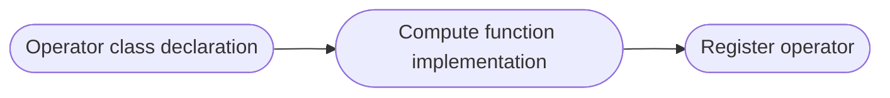

# AI CPU Operator Development Guide

<!-- md-trans-meta sourceCommit=unknown translatedAt=2026-11-12T12:13:16.784Z pushedAt=2026-11-18T02:51:06.800Z nl=2 -->

## Overview

> Note:
>
> 1. For detailed information about basic concepts and AI CPU APIs involved during operator development, see [*TBE & AI CPU Operator Development*](https://hiascend.com/en/document/redirect/CannCommunityOpdevWizard).
> 2. An AI CPU operator is developed in C++ and runs on the AI CPU hardware unit.
> 3. build.sh: Commands involved during operator development can be viewed through `bash build.sh --help`. For function parameter descriptions, see [build parameter description](../install/build.md).

The development guide uses the `AddExample` operator development as an example to introduce the new operator development process and the deliverables involved. For the complete sample code, see the `examples` directory of the project.

1. [Project Creation](#project-creation): Before developing an operator, complete the environment deployment and create the operator directory to facilitate subsequent operator compilation and deployment.
2. [Operator Definition](#operator-definition): Determine the operator function and prototype definition.
3. [Kernel Implementation](#kernel-implementation): Implement the Device-side operator kernel function.
4. [aclnn Adaptation](#aclnn-adaptation): For custom operators, the aclnn API call is recommended, and binary release must be completed in advance. **If the operator is called in graph mode**, see [Graph Mode Adaptation Guide](./graph_develop_guide.md).
5. [Build and Deployment](#build-and-deployment): Complete the compilation and installation of the custom operator through the project build script.
6. [Operator Verification](#operator-verification): Verify the custom operator function through common operator call methods.

## Project Creation

**1. Environment Deployment**

Before developing an operator, see [Environment Deployment](../install/quick_install.md) to complete basic environment setup.

**2. Directory Creation**

Directory creation is an important step in operator development. It provides a unified directory structure and file organization method for subsequent code writing, compilation and building, and verification.

The operator directory can be quickly created through `build.sh`. Enter the project root directory and execute the following command:

```bash
# Create the specified operator directory, for example, bash build.sh --genop_aicpu=examples/add_example
# ${op_class} indicates the operator type, such as the transformer class.
# ${op_name} indicates the lowercase underscore form of the operator name, for example, the `AddExample` operator corresponds to add_example. A newly added operator is not allowed to have the same name as an existing operator.
bash build.sh --genop_aicpu=${op_class}/${op_name}
```

After the command is executed successfully, the following prompt information is displayed:

```bash
Create the AI CPU initial directory for ${op_name} under ${op_class} success
```

After creation is complete, the directory structure is as follows:

```text
${op_name}                              # Replace with the lowercase underscore form of the actual operator name
├── examples                            # Operator call example
│   └── test_aclnn_${op_name}.cpp       # Operator aclnn call example
├── op_host                             # Host-side implementation
│   └── ${op_name}_infershape.cpp       # InferShape implementation, implements operator shape inference and derives the output shape at runtime
├── op_kernel_aicpu                     # Device-side Kernel implementation
│   ├── ${op_name}_aicpu.cpp            # Kernel entry file, containing the main function and scheduling logic
│   ├── ${op_name}_aicpu.h              # Kernel header file, containing function declarations, structure definitions, and logic implementation
│   └── ${op_name}.json                 # Operator information library, defining basic operator information such as name, input/output, and data type
├── tests                               # UT implementation
│   └── ut                              # kernel/aclnn UT implementation
└── CMakeLists.txt                      # Operator cmakelist entry
```

If ```${op_class}``` is a new operator classification, additionally add ```add_subdirectory(${op_class})``` in `CMakeLists`. Otherwise, compilation fails.

 ```text
 if(ENABLE_EXPERIMENTAL)
   # genop adds an experimental operator classification
   # add_subdirectory(${op_class})
   add_subdirectory(experimental/transformer)
 else()
   # genop adds a non-experimental operator classification
   # add_subdirectory(${op_class})
   add_subdirectory(transformer)
 endif()
 ```

## Operator Definition

Operator definition requires two deliverables: `README.md` and ```${op_name}.json```

**Deliverable 1: README.md**

Before developing an operator, determine the function and computation logic of the target operator.

Using the custom `AddExample` operator description as an example, see [AddExample Operator Description](../../../examples/add_example/README.md).

**Deliverable 2: ${op_name}.json**

Operator information library.

Using the custom `AddExample` operator description as an example, see [AddExample Operator Information Library](../../../examples/add_example/op_kernel_aicpu/add_example.json).

## Kernel Implementation

### Kernel Introduction

Kernel is the core part of an operator executed on the NPU. Kernel implementation includes the following steps:



### Code Implementation

Kernel requires two deliverables: ```${op_name}_aicpu.cpp``` and ```${op_name}_aicpu.h```

**Deliverable 1: ${op_name}_aicpu.h**

Operator class declaration

The first step of Kernel implementation is to declare the operator class in the header file ```op_kernel_aicpu/${op_name}_aicpu.h```. The operator class must inherit the CpuKernel base class.
For detailed implementation, see [add_example_aicpu.h](../../../examples/add_example/op_kernel_aicpu/add_example_aicpu.h).

```CPP
// 1. Operator class declaration
// Include the AI CPU basic library header file
#include "cpu_kernel.h"
// Define the namespace aicpu (fixed and not allowed to be modified), and define the operator Compute implementation function
namespace aicpu {
// The operator class inherits the CpuKernel base class
class AddExampleCpuKernel : public CpuKernel {
 public:
  ~AddExampleCpuKernel() = default;
  // Declare the function Compute (needs to be overridden). The parameter CpuKernelContext is the context of CPUKernel, including operator input, output, and attribute information
  uint32_t Compute(CpuKernelContext &ctx) override;
};
}  // namespace aicpu
```

**Deliverable 2: ${op_name}_aicpu.cpp**

Compute function implementation and AI CPU operator registration

Obtain the input/output Tensor information and perform validity verification, then implement the core computation logic (such as addition), and set the computation result to the output Tensor.

For detailed implementation, see [add_example_aicpu.cpp](../../../examples/add_example/op_kernel_aicpu/add_example_aicpu.cpp).

```C++
// 2. Compute function implementation
#include "add_example_aicpu.h"

namespace {
// Operator name
const char* const kAddExample = "AddExample";
const uint32_t kParamInvalid = 1;
}  // namespace

// Define the namespace aicpu
namespace aicpu {
// Implement the Compute function of the custom operator class
uint32_t AddExampleCpuKernel::Compute(CpuKernelContext& ctx) {
  // Obtain the input tensor from CpuKernelContext
  Tensor* input0 = ctx.Input(0);
  Tensor* input1 = ctx.Input(1);
  // Obtain the output tensor from CpuKernelContext
  Tensor* output = ctx.Output(0);

  // Perform basic verification on the tensor to determine whether it is a null pointer
  if (input0 == nullptr || input1 == nullptr || output == nullptr) {
    return kParamInvalid;
  }

  // Obtain the data type of the input tensor
  auto data_type = static_cast<DataType>(input0->GetDataType());
  // Obtain the data address of the input tensor, for example, the input data type is int32
  auto input0_data = reinterpret_cast<int32_t*>(input0->GetData());
  // Obtain the shape of the tensor
  auto input0_shape = input0->GetTensorShape();

  // Obtain the data address of the output tensor, for example, the output data type is int32
  auto y = reinterpret_cast<int32_t*>(output->GetData());

  // The AddCompute function performs the corresponding computation based on the input type.
  // Since C++ does not natively support half-precision floating-point types, the third-party library Eigen (version 3.3.9 recommended) can be used for representation.
  switch (data_type) {
    case DT_FLOAT:
      return AddCompute<float>(...);
    case DT_INT32:
      return AddCompute<int32_t>(...);
      ....
    default : return kParamInvalid;
  }
}

// 3. Register the operator Kernel implementation, used by the framework to obtain the Compute function of the operator Kernel.
REGISTER_CPU_KERNEL(kAddExample, AddExampleCpuKernel);
}  // namespace aicpu
```

## aclnn Adaptation

After operator development and compilation are complete, the aclnn API (a set of C-based APIs) is automatically generated. No other configuration is required. The aclnn API can be directly called in the application to implement the operator call.

## Build and Deployment

After operator development is complete, compile the operator project to generate the custom operator installation package `*.run`. The specific operations are as follows:

1. **Prepare the environment.**

   See [Project Creation](#project-creation) to complete basic environment setup, and check whether the operator development deliverables are complete and located in the corresponding operator classification directory.
2. **Compile the custom operator package.**

   Using the `AddExample` operator as an example, assume the development deliverables are in the `examples` directory. For the complete code, see the [add_example](../../../examples/add_example/op_kernel_aicpu) directory.

   ```bash
   # Compile the specified operator, for example, bash build.sh --pkg --ops=add_example --opkernel_aicpu -j16
   bash build.sh --pkg --soc=${soc_version} --vendor_name=${vendor_name} --ops=${op_list} --opkernel_aicpu [--experimental] [-j${n}]
   ```

   - --soc: \$\{soc\_version\} indicates the NPU model. Atlas A2 products use "ascend910b" (default), Atlas A3 products use "ascend910_93", and Ascend 950PR&950DT products use "ascend950".
   - --vendor_name (optional): \$\{vendor\_name\} indicates the name of the built custom operator package. The default name is custom.
   - --ops (optional): \$\{op\_list\} indicates the operator to be compiled. If not specified, all operators are compiled by default. The format is "--ops=add_example".
   - --opkernel_aicpu: Enables ENABLE_AICPU_KERNEL to compile kernel_aicpu.
   - --experimental (optional): If the compiled operator is a contributed operator, configure --experimental.
   - -j (optional): Specifies the number of compilation threads to speed up compilation.

   If the following information is displayed, the compilation is successful:

   ```bash
   Self-extractable archive "cann-ops-transformer-${vendor_name}_linux-${arch}.run" successfully created.
   ```

3. **Install the custom operator package.**

   ```bash
   # Install the run package
   ./build_out/cann-ops-transformer-${vendor_name}_linux-${arch}.run
   ```

   The custom operator package is installed in the ```${ASCEND_HOME_PATH}/opp/vendors``` path. ```${ASCEND_HOME_PATH}``` indicates the CANN software installation directory, which can be configured in the environment variable in advance.
4. **(Optional) Uninstall the custom operator package.**

   After the custom operator package is installed, `uninstall.sh` is generated in the ```${ASCEND_HOME_PATH}/opp/vendors/custom_transformer/scripts``` directory. The custom operator package can be uninstalled through this script. The command is as follows:

   ```bash
   bash ${ASCEND_HOME_PATH}/opp/vendors/${vendor_name}_transformer/scripts/uninstall.sh
   ```

## Operator Verification

Before verifying the operator, ensure that the environment variable has been configured. The command is as follows:

```bash
export LD_LIBRARY_PATH=${ASCEND_HOME_PATH}/opp/vendors/${vendor_name}_transformer/op_api/lib:${LD_LIBRARY_PATH}
export ASCEND_CUSTOM_OPP_PATH=${ASCEND_HOME_PATH}/opp/vendors/${vendor_name}_transformer
```

- **UT Verification**

  During operator development, quick verification can be performed through UT verification (such as Kernel). For detailed implementation, see [Kernel UT](../../../examples/add_example/tests/ut/op_kernel_aicpu/test_add_example.cpp).
- **aclnn Call Verification**

  After the developed operator is compiled and deployed, the function can be verified through the aclnn method. For the method, see [Operator Call Method](../invocation/quick_op_invocation.md).
